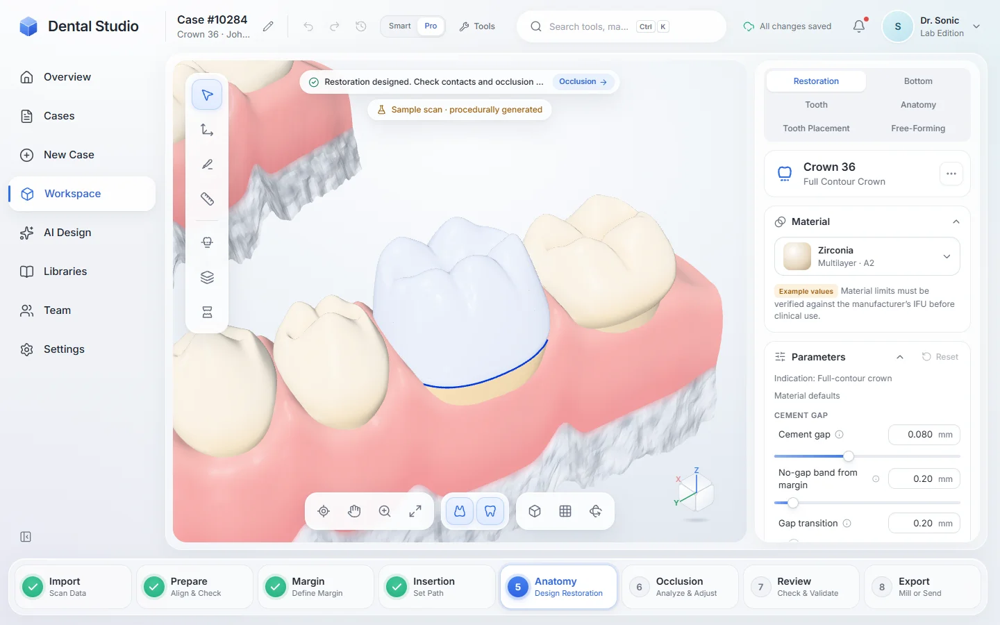
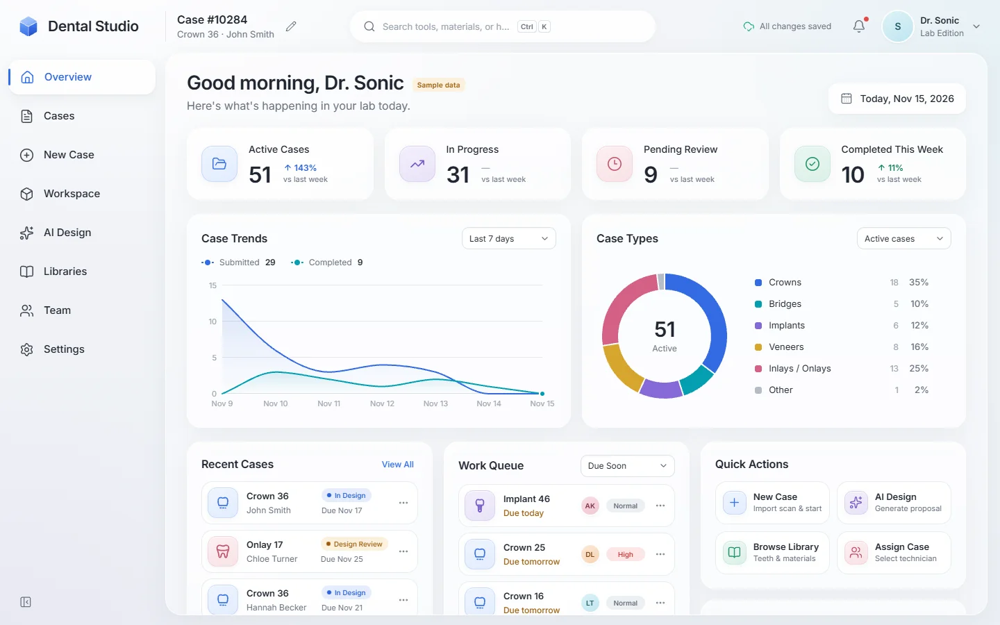
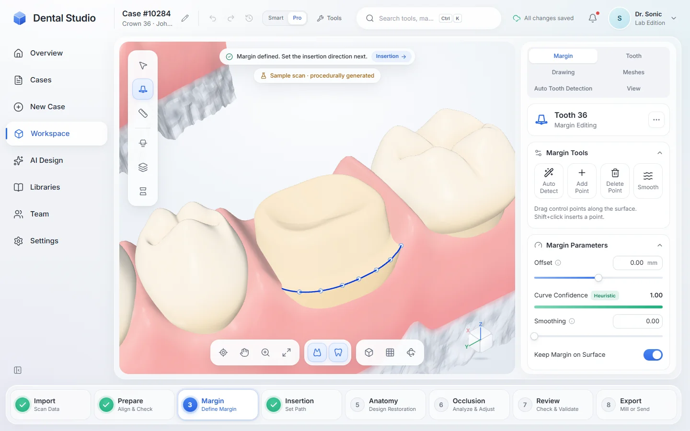
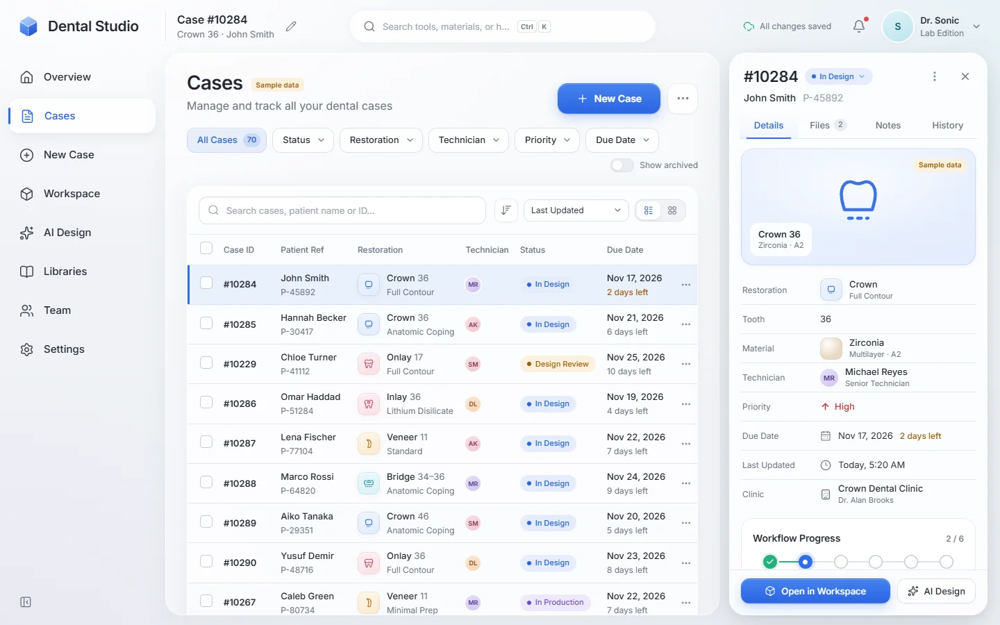
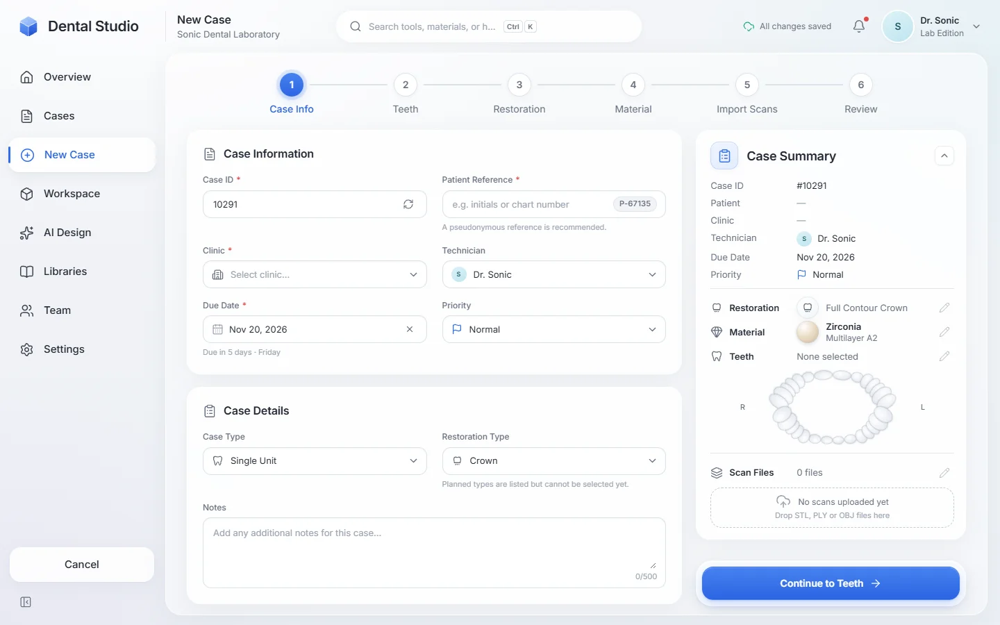

<h1 align="center">Dental Studio</h1>

<b>Next-generation dental CAD for laboratories</b> 
Windows desktop + web · a premium <i>Minimal Liquid Glass</i> interface · a measurement-first geometry engine.

## Highlights

- **Single-crown CAD pipeline** — margin detection & editing → insertion axis & undercuts → anatomical crown with cement gap → contact / antagonist fitting → minimum-thickness enforcement → sculpting → occlusion & thickness analysis → validation → STL export.
- **Real scans** — import STL / PLY / OBJ; unsegmented jaw scans run the same pipeline after a two-click tooth frame.
- **Lab workflow** — dashboard, case management, new-case wizard with a 3D tooth chart, design proposal comparison, final review & export.
- **Material rules** — zirconia and lithium-disilicate thickness and gap parameters.
- **Arabic & English (RTL)**, light / dark themes, command palette and customizable shortcuts.

## Screenshots

| Lab overview | Margin definition |
|---|---|
|  |  |
| **Case management** | **New case** |
|  |  |

## Built with

React 19 · TypeScript · Vite · Three.js geometry engine · Tauri 2 (Windows desktop).

> **Prototype — not a medical device.** No clinical validation or regulatory clearance. Sample data and material limits shown are example values.

---

**Proprietary software.** Dental Studio is closed source; this repository only presents the project. © 2026 Mohammed Abdulsalam — all rights reserved.
